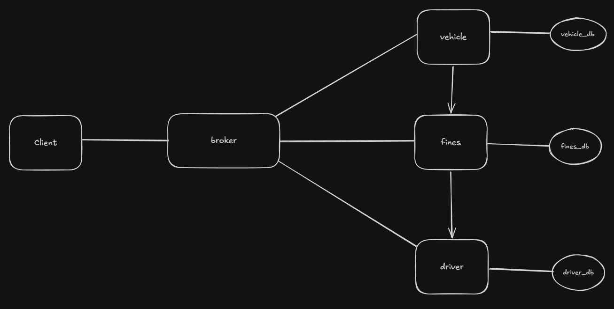

# Denatran

É um sistema de para gerenciar veículos e condutores presentes em todos os estados do país.

## Arquitetura
 


Cada serviço é um módulo Go independente (`go.mod`/`go.sum` próprios), com seu
próprio `Dockerfile` e seu próprio banco de dados (*database per service*).

| Serviço   | Responsabilidade                              | Tópicos que assina                                                                                   |
|-----------|-----------------------------------------------|------------------------------------------------------------------------------------------------------|
| `driver`  | Cadastro de condutores                        | `driver/register`, `driver/get`                                                                      |
| `vehicle` | Emplacamento, IPVA, transferência             | `vehicle/register`, `vehicle/ipva`, `vehicle/transfer`, `vehicle/query/year`, `vehicle/get`          |
| `fines`   | Multas e ranking de pontuação                 | `fine/register`, `fines/query/plate`, `fines/query/driver`, `fines/query/year`, `fines/query/points` |
| `client`  | CLI para usar o sistema (e rodar o `demo`)    | — (publica nos tópicos acima)


### Request/response sobre MQTT

MQTT é publish/subscribe, então as consultas usam o padrão *request/reply*:

* **Requisição** — JSON publicado no tópico do serviço, com dois campos extras:
  `reply_to` (tópico exclusivo de quem pergunta) e `id` (correlação).
* **Resposta** — publicada em `reply_to`:
  `{"id": "...", "ok": true, "data": {...}}` ou `{"id": "...", "ok": false, "error": "..."}`.

Os próprios serviços conversam entre si assim:

* `vehicle` → `driver/get` para validar o CPF ao emplacar e ao transferir;
* `fines` → `vehicle/get` para descobrir o dono do veículo ao lançar uma multa;
* `fines` → `driver/get` para anexar os dados do condutor nas consultas e no ranking.

> A multa guarda o CPF do dono no momento em que foi lançada. Se o veículo for
> transferido depois, as multas antigas continuam com o condutor que as recebeu.

## Tópicos e payloads

| Funcionalidade                                  | Tópico               | Payload                                                  |
|-------------------------------------------------|----------------------|----------------------------------------------------------|
| Emplacar veículo                                | `vehicle/register`   | `placa`, `modelo`, `valor`, `cpf`, `ano` *(opcional)*    |
| Calcular IPVA (2%)                              | `vehicle/ipva`       | `placa`                                                  |
| Transferir proprietário                         | `vehicle/transfer`   | `placa`, `cpf` (novo dono)                               |
| Cadastrar condutor                              | `driver/register`    | `cpf`, `nome`                                            |
| Lançar multa                                    | `fine/register`      | `ano`, `descricao`, `pontuacao`, `placa`                 |
| Veículos emplacados em um ano                   | `vehicle/query/year` | `ano`                                                    |
| Multas de um veículo (com dados do condutor)    | `fines/query/plate`  | `placa`, `ano` *(opcional: sem ano = todos)*             |
| Multas de um condutor em um ano                 | `fines/query/driver` | `cpf`, `ano` *(opcional: sem ano = todos)*               |
| Multas lançadas em um ano                       | `fines/query/year`   | `ano`                                                    |
| Top 5 condutores por pontuação (decrescente)    | `fines/query/points` | `{}`                                                     |

## Como rodar

Pré-requisito: Docker com Docker Compose.

```bash
# 1. Subir broker, bancos de dados e os 3 microsserviços
docker compose up --build -d

# 2. Acompanhar os logs (opcional)
docker compose logs -f driver vehicle fines

# 3. Rodar o cenário de teste completo (cria dados, consulta e verifica os resultados)
docker compose run --rm client demo

# 4. Encerrar (acrescente -v para apagar também os dados dos bancos)
docker compose down
```

O `demo` usa CPFs e placas únicos a cada execução, então pode ser repetido à vontade.
Ele termina com código de saída diferente de zero se alguma verificação falhar.

### Usando o cliente manualmente

```bash
docker compose run --rm client driver-register  -cpf 11111111111 -nome "Maria Silva"
docker compose run --rm client vehicle-register -placa ABC1D23 -modelo Gol -valor 50000 -cpf 11111111111 -ano 2024
docker compose run --rm client vehicle-ipva     -placa ABC1D23
docker compose run --rm client driver-register  -cpf 22222222222 -nome "João Souza"
docker compose run --rm client vehicle-transfer -placa ABC1D23 -cpf 22222222222
docker compose run --rm client vehicle-year     -ano 2024
docker compose run --rm client fine-register    -ano 2024 -descricao "Excesso de velocidade" -pontuacao 7 -placa ABC1D23
docker compose run --rm client fines-plate      -placa ABC1D23 -ano 2024
docker compose run --rm client fines-driver     -cpf 22222222222 -ano 2024
docker compose run --rm client fines-year       -ano 2024
docker compose run --rm client fines-top
docker compose run --rm client -h               # lista de comandos
```

## Estrutura

```
.
├── docker-compose.yml
├── broker/mosquitto.conf
├── driver/    # main.go, db.go, mqtt.go, Dockerfile, go.mod, go.sum
├── vehicle/   # main.go, db.go, mqtt.go, rpc.go, Dockerfile, go.mod, go.sum
├── fines/     # main.go, db.go, mqtt.go, rpc.go, Dockerfile, go.mod, go.sum
└── client/    # main.go (CLI), demo.go (cenário de teste), Dockerfile, go.mod, go.sum
```

`mqtt.go` e `rpc.go` são cópias intencionais entre os serviços: como cada um é um
módulo independente (e é construído isoladamente pelo Docker), não há pacote compartilhado.

